# RLCM: Test Passives for GF180MCUD

RLCM is a test chip of on-chip passives in the open-source
[GF180MCU](https://gf180mcu-pdk.readthedocs.io/) process, taped out on the
[wafer.space](https://wafer.space/) GF180MCU Run 2 shuttle. It was designed by
[Ghaith Al Sabagh](https://github.com/EngGhaith)
([Institute for Communications Engineering and RF-Systems](https://www.jku.at/en/institute-for-communications-engineering-and-rf-systems/),
Johannes Kepler University Linz). The project description on wafer.space reads:

> This TO aims to have a kind of test passives to verify the automated openEMS
> flow used to simulate passives on GF180MCUD.

The die carries two metal-insulator-metal (MIM) capacitors, two spiral
inductors, a symmetric inductor with a centre tap, two transformers, and the
open, joined and thru structures required to de-embed the pads and feed lines
from a measurement. Each structure is connected to its own
[probe launch](#probe-launches), a block of pads in which two ground pads
enclose two or three signal pads, and no structure requires a supply. The
S-parameters measured on silicon can therefore be compared directly with an
electromagnetic (EM) simulation of the same GDS geometry in
[openEMS](https://www.openems.de/). The difference between the two is a
measure of the accuracy of the simulation setup for this process.

## Status

Silicon is expected in November 2026. No measurements exist yet.

| Property | Value |
|---|---|
| Shuttle | wafer.space GF180MCU Run 2, shuttle ID G802 |
| Project code | `RLCM` |
| Manufacturing ID | `G802RLCM` |
| Project list entry | "RLCM: Test Passives For GF180MCUD" in [wafer-space/ws-run2](https://github.com/wafer-space/ws-run2) |
| Status on wafer.space | Manufacturable |
| Created | 2026-07-13 |
| Submitted | 2026-07-15 |
| Slot | 0.5&nbsp;×&nbsp;1, half width. Listed on wafer.space as 1.94&nbsp;mm&nbsp;×&nbsp;5.07&nbsp;mm (9.84&nbsp;mm²) |
| Packaging | Chip on board (CoB) |
| Process | GF180MCU, `gf180mcuD` PDK variant (five metal layers) |
| Submitted layout | [`RLCMV4_filled.zip`](RLCMV4_filled.zip), top cell `RLCMV4_filled` |
| Die size in the layout | 1936&nbsp;µm&nbsp;×&nbsp;5122&nbsp;µm |
| License | [CERN-OHL-P v2](LICENSE) |

## The whole chip

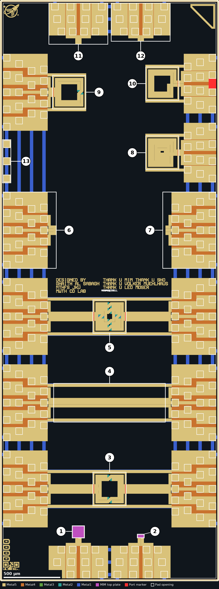

*Layout of the die. The numbers are those of the
[index of structures](#index-of-structures). Only the five routing metals, the
MIM top plate, the pad openings and the EM port markers are drawn. The red
block at the right edge beside structure 10 is a stray rectangle on a port
layer, described under
[Spiral inductors in `docs/README.md`](docs/README.md#spiral-inductors).*


*All 246 pad openings, coloured by role. The small numbers around the edge
are the 72 frame pads, counted counterclockwise from the lower left corner.
The pad tables are in [`docs/README.md`](docs/README.md#pads).*

## Index of structures

The size is the bounding box of the layout cell as placed and the origin is
its lower left corner, both in the coordinates of the top cell.

| # | Structure | Layout cell | Size (µm) | Origin (µm) | Full details |
|---|---|---|---|---|---|
| [^1] | MIM capacitor, large | `cap_mim` | 101.2&nbsp;×&nbsp;101.2 | 641.4,&nbsp;384.3 | [MIM capacitors](docs/README.md#mim-capacitors) |
| [^2] | MIM capacitor, small | `cap_mim$1` | 55.2&nbsp;×&nbsp;26.2 | 1216.4,&nbsp;384.3 | [MIM capacitors](docs/README.md#mim-capacitors) |
| [^3] | Transformer, one turn per winding | `SymmetricTransformer` | 298&nbsp;×&nbsp;298 | 819,&nbsp;664 | [Transformers](docs/README.md#transformers) |
| [^4] | Three-line thru | three Metal5 rectangles in the top cell | 990&nbsp;×&nbsp;82 | 473,&nbsp;1532 | [De-embedding structures](docs/README.md#de-embedding-structures) |
| [^5] | Transformer, two turns per winding | `SymmetricTransformer$2` | 298&nbsp;×&nbsp;298 | 819,&nbsp;2184 | [Transformers](docs/README.md#transformers) |
| [^6] | Three-port launch, signals joined | `Probes_3P$2$1$2$1` | 447&nbsp;×&nbsp;676 | 26,&nbsp;2755 | [De-embedding structures](docs/README.md#de-embedding-structures) |
| [^7] | Three-port launch, signals open | `Probes_3P$2$2$1$1` | 447&nbsp;×&nbsp;676 | 1463,&nbsp;2755 | [De-embedding structures](docs/README.md#de-embedding-structures) |
| [^8] | Spiral inductor, four turns | `SpiralInductor_2P_282x282$1` | 298&nbsp;×&nbsp;298 | 1284.7,&nbsp;3628 | [Spiral inductors](docs/README.md#spiral-inductors) |
| [^9] | Symmetric inductor with centre tap | `SymmetricInductor_3P_282x282` | 298&nbsp;×&nbsp;298 | 462,&nbsp;4160 | [Symmetric inductor](docs/README.md#symmetric-inductor), [`seperate_GDSs/`](seperate_GDSs/README.md#symmetric-inductor) |
| [^10] | Spiral inductor, two turns | `SpiralInductor_2P_282x282` | 298&nbsp;×&nbsp;298 | 1284.7,&nbsp;4236 | [Spiral inductors](docs/README.md#spiral-inductors), [`seperate_GDSs/`](seperate_GDSs/README.md#spiral-inductor) |
| [^11] | Two-port launch, signals joined | `Probes_2P_DEEMD$1` | 524&nbsp;×&nbsp;338.3 | 430,&nbsp;4757.7 | [De-embedding structures](docs/README.md#de-embedding-structures) |
| [^12] | Two-port launch, signals open | `Probes_2P_DEEMD` | 524&nbsp;×&nbsp;338.3 | 982,&nbsp;4757.7 | [De-embedding structures](docs/README.md#de-embedding-structures) |
| [^13] | Unconnected bond pads | three of `Bondpad_5LM` | 68&nbsp;×&nbsp;369.3 | 26,&nbsp;3515 | [Pads](docs/README.md#pads) |

[^1]: MIM capacitor with a 100 µm × 100 µm top plate, connected in series between the two signal pads of a two-port launch.
[^2]: MIM capacitor with a 54 µm × 25 µm top plate, connected in series between the two signal pads of a two-port launch.
[^3]: Two interleaved single-turn windings on two rings of 26 µm track. Three-port launches on the left and right.
[^4]: Three parallel Metal5 lines, 990 µm long, that join the three signal pads of the left launch straight to those of the right launch.
[^5]: Two interleaved two-turn windings on four rings of 24 µm track. Three-port launches on the left and right.
[^6]: A three-port launch on its own, with the three signal stubs joined by a Metal5 bar.
[^7]: A three-port launch on its own, with the three signal stubs left open.
[^8]: Square spiral, four turns of 26 µm track wound to the centre, on a two-port launch.
[^9]: Square symmetric inductor, two turns of 26 µm track with one crossover and a centre tap, on a three-port launch.
[^10]: Square spiral, two turns of 26 µm track around a 142 µm opening, on a two-port launch.
[^11]: A two-port launch on its own, with the two signal stubs joined.
[^12]: A two-port launch on its own, with the two signal stubs left open.
[^13]: Three frame pads on the left edge that connect to nothing.

### Repository contents

| Location | Contents |
|---|---|
| [`RLCMV4_filled.zip`](RLCMV4_filled.zip) | The submitted layout as one GDS file, with dummy fill and seal ring |
| [`seperate_GDSs/`](seperate_GDSs/README.md) | Stand-alone GDS files of two of the inductors and of the two pad frames |
| [`docs/README.md`](docs/README.md) | Full details of every structure in the submitted layout, and the pad tables |
| [`docs/scripts/expected_values.py`](docs/scripts/expected_values.py) | The hand calculations behind the expected values quoted in the sections on each structure type |
| [`docs/updating-images.md`](docs/updating-images.md) | The procedure for regenerating the pictures in this documentation |

## Probe launches

Every structure is connected to a probe launch at the die edge. In this
documentation a launch is a block of ground (G) and signal (S) pads in a
ground-signal-signal-ground (GSSG) or ground-signal-signal-signal-ground
(GSSSG) arrangement. A launch repeats the same pads on several rows at
different pitches, so a structure can be measured with wafer probes of more
than one pitch or wire bonded from the frame row. The two launch types are:

| Launch | Layout cells | Pad order | Used by |
|---|---|---|---|
| Two-port | `Probes_2P`, `Probes_2P_DEEMD` | G S1 S2 G | [^1] [^2] [^8] [^10] [^11] [^12] |
| Three-port | `Probes_3P` | G S1 S2 S3 G | [^3] [^4] [^5] [^6] [^7] [^9] |

The rows of each launch, counted from the die edge inwards, are:

| Row | Pitch (µm) | Pads in a two-port launch | Pads in a three-port launch |
|---|---|---|---|
| Frame row, 58 µm from the die edge | 138 on the top and bottom edges, 152 on the left and right edges | G S1 S2 G | G S1 S2 S3 G |
| Second row, 168 µm in | 125 | G S1 S2 G | G S1 S2 S3 G |
| Third row, 278 µm in | 100 in a two-port launch, 125 in a three-port launch | G S1 S2 G | G S1 S3 G |
| Fourth row, 388 µm in | 100 | none | G S1 S2 S3 G |

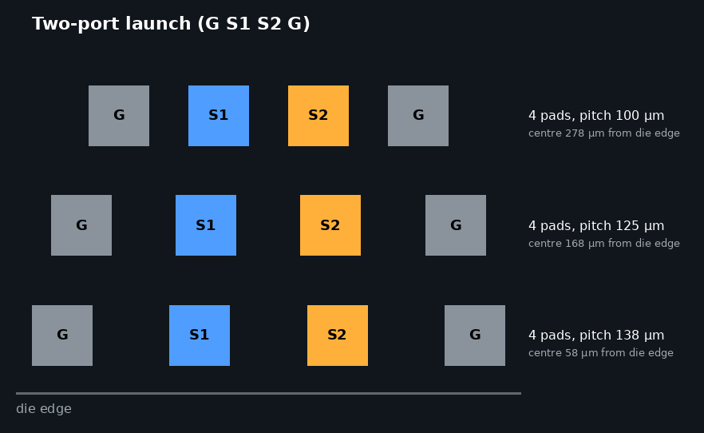

*Pad rows of a two-port launch on the top or bottom edge. On the left and
right edges the frame row has a pitch of 152 µm.*

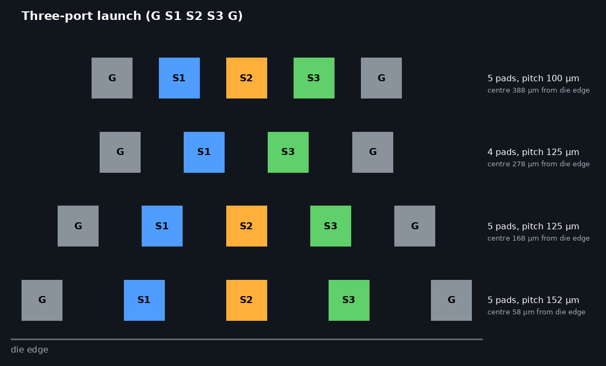

*Pad rows of a three-port launch. The third row has no S2 pad.*

All pad openings are 60 µm × 60 µm. The names G, S1, S2 and S3 are used
only in this documentation, because the layout has no pin labels. S1 is the
signal pad with the lowest x or y coordinate. The launch cells, the ground
connections and the pad tables are described under
[Probe launches in `docs/README.md`](docs/README.md#probe-launches).

## MIM capacitors

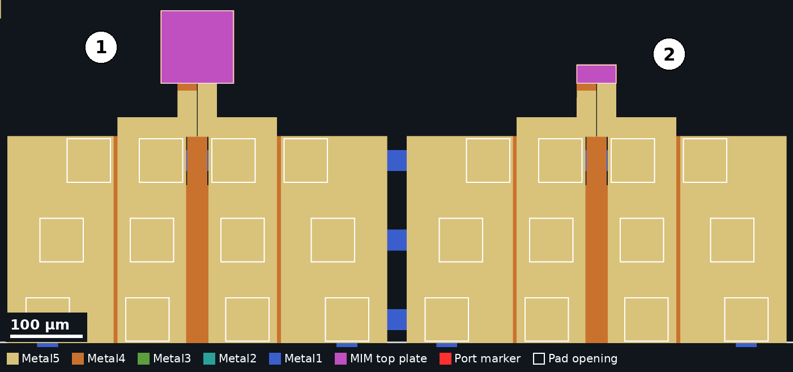

The die carries two MIM capacitors between Metal4 (bottom plate) and Metal5
(top plate, through the MIM top plate layer). Each capacitor is a series
element between the two signal pads: S1 connects to the bottom plate and S2
to the top plate.

| # | Top plate (µm) | Area (µm²) | Expected capacitance |
|---|---|---|---|
| [^1] | 100&nbsp;×&nbsp;100 | 10000 | 20 pF (18 pF to 22 pF) |
| [^2] | 54&nbsp;×&nbsp;25 | 1350 | 2.7 pF (2.43 pF to 2.97 pF) |

The full description is under
[MIM capacitors in `docs/README.md`](docs/README.md#mim-capacitors).

### Measurement

The capacitors are probed on two-port launches on the bottom edge, with the
pad order G S1 S2 G. The two-port S-parameters are measured and the launch is
removed using the open and joined launches [^12] and [^11], which use the
same launch cell. After conversion to Y-parameters, the series capacitance
well below self-resonance is `-Im(Y21) / (2πf)`.

### Expected values

The expected capacitance is the top plate area multiplied by the capacitance
per unit area of 2.0 fF/µm² (1.8 fF/µm² to 2.2 fF/µm²) that the
[PDK lists](https://gf180mcu-pdk.readthedocs.io/en/latest/analog/spice/elec_specs/elec_specs_6_4.html)
for its densest MIM option, which is the value the `gf180mcuD` tooling
assumes. No EM simulation result is recorded in this repository.

### Further reading

1. G. Al Sabagh, [EM stack files for GF180MCUD](https://github.com/EngGhaith/The-Silent-Owl-GF180MCU-WB-LNA/tree/main/EM-Flow), with notes on how the MIM layers must be prepared for simulation.
2. GF180MCU PDK documentation, [MIM capacitor electrical specification](https://gf180mcu-pdk.readthedocs.io/en/latest/analog/spice/elec_specs/elec_specs_6_4.html) and [MIM option B layout rules](https://gf180mcu-pdk.readthedocs.io/en/latest/physical_verification/design_manual/drm_10_4_2.html).

## Spiral inductors

| Two turns [^10] | Four turns [^8] |
|---|---|
| 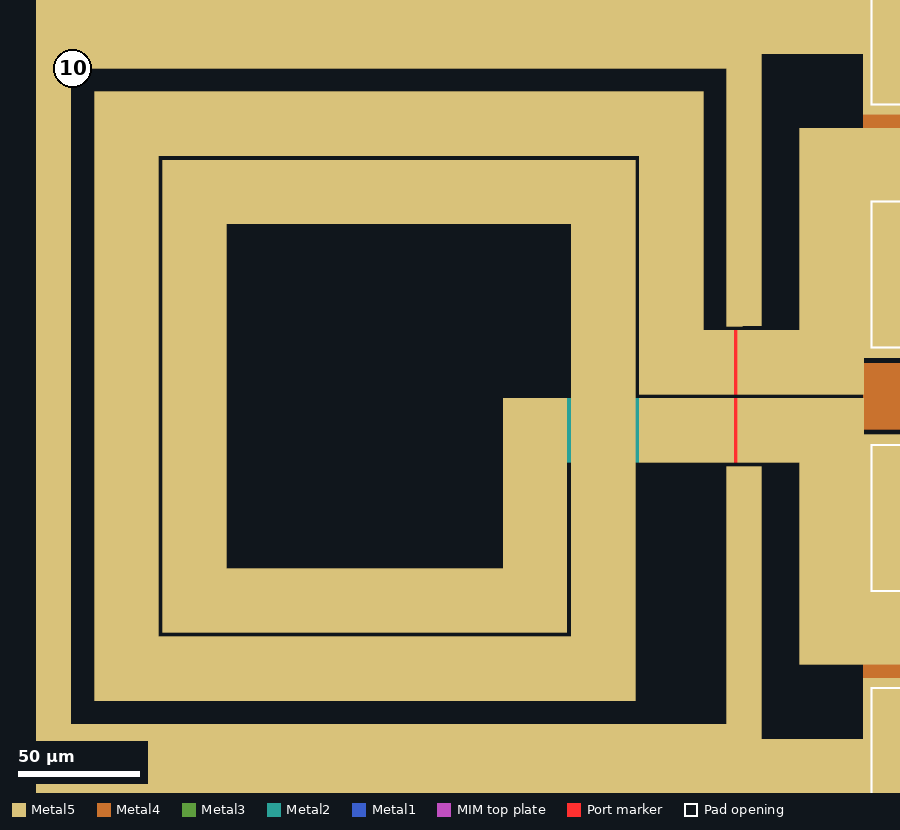 | 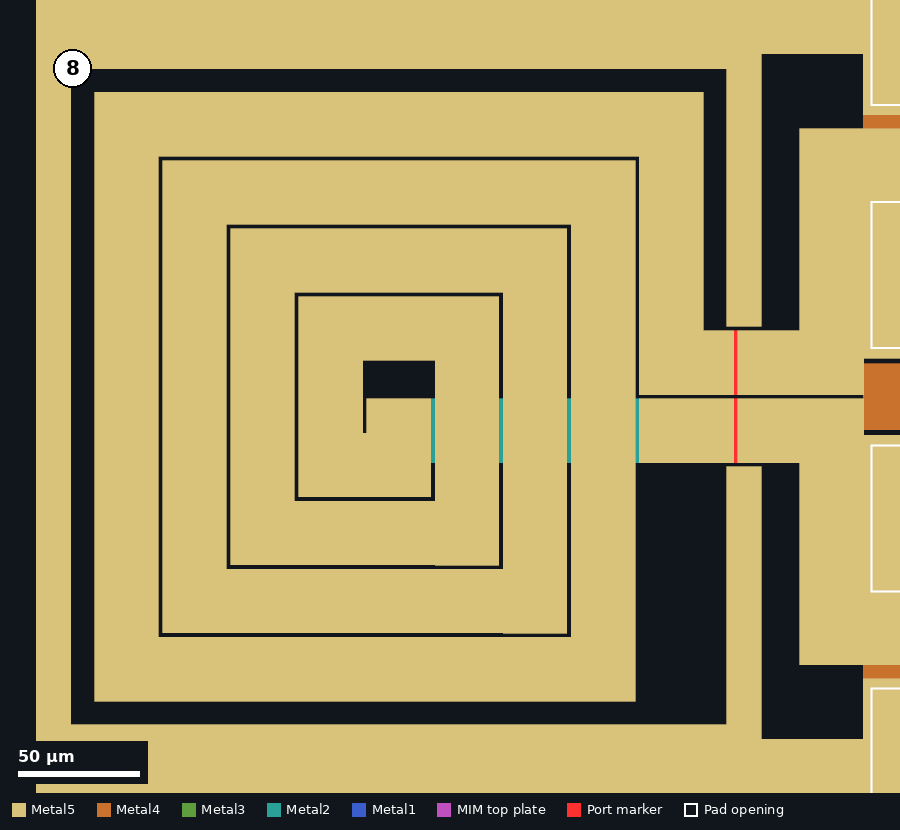 |

The two inductors are square spirals with the same 250 µm outer dimension,
26 µm track width and 2 µm spacing. All five metals are stacked and
connected by via arrays along the winding. The inner end is brought out
through an underpass on Metal1 and Metal2 beneath the turns.

| # | Turns | Inner opening (µm) | Expected inductance | Expected DC resistance |
|---|---|---|---|---|
| [^10] | 2 | 142 | 1.3 nH | 0.8 Ω |
| [^8] | 4 | 30 | 2.1 nH | 1.2 Ω |

The full description is under
[Spiral inductors in `docs/README.md`](docs/README.md#spiral-inductors). The
two-turn spiral is also available as a stand-alone file in
[`seperate_GDSs/`](seperate_GDSs/README.md#spiral-inductor).

### Measurement

The inductors are probed on two-port launches on the right edge, with the pad
order G S1 S2 G. S1 is the inner end of the spiral and S2 the outer end. The
two-port S-parameters are measured, de-embedded and converted to
Y-parameters. With port 2 grounded, the inductance and quality factor are
`L = Im(1/Y11) / (2πf)` and `Q = Im(1/Y11) / Re(1/Y11)`. The same expressions
applied to `-1/Y21` give the values for the series branch.

### Expected values

The inductance is calculated from the current sheet expression of
[Mohan et al.](https://doi.org/10.1109/4.792620) and the DC resistance from
the
[PDK sheet resistances](https://gf180mcu-pdk.readthedocs.io/en/latest/analog/layout/inter_specs/inter_specs_4.html).
Both are hand calculations that ignore the substrate, the ground ring and the
underpass. They are derived under
[Expected values in `docs/README.md`](docs/README.md#expected-values). The
quality factor and the self-resonant frequency can only be obtained from an
EM simulation, and no simulation result is recorded in this repository.

### Further reading

1. V. Mühlhaus, [gds2openEMS](https://github.com/VolkerMuehlhaus/gds2openEMS), the GDS to openEMS workflow, with inductor examples.
2. S. S. Mohan, M. del Mar Hershenson, S. P. Boyd and T. H. Lee, "Simple accurate expressions for planar spiral inductances", IEEE J. Solid-State Circuits, vol. 34, no. 10, pp. 1419-1424, 1999. [doi:10.1109/4.792620](https://doi.org/10.1109/4.792620)
3. C. P. Yue and S. S. Wong, "Physical modeling of spiral inductors on silicon", IEEE Trans. Electron Devices, vol. 47, no. 3, pp. 560-568, 2000. [doi:10.1109/16.824729](https://doi.org/10.1109/16.824729)
4. A. M. Niknejad and R. G. Meyer, "Analysis, design, and optimization of spiral inductors and transformers for Si RF ICs", IEEE J. Solid-State Circuits, vol. 33, no. 10, pp. 1470-1481, 1998. [doi:10.1109/4.720393](https://doi.org/10.1109/4.720393)

## Symmetric inductor

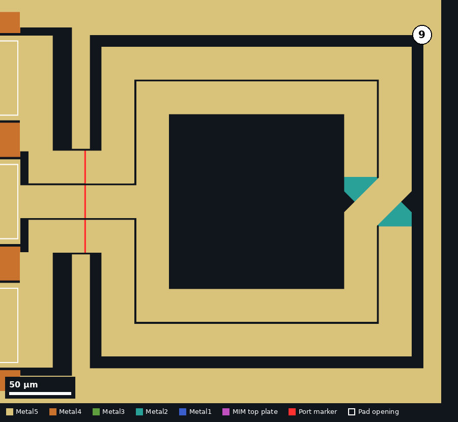

Structure [^9] is a square, two-turn symmetric (differential) inductor with
the same 250 µm outer dimension, 26 µm track width and 2 µm spacing as the
spiral inductors. The two turns exchange position at one crossover, where one
path remains on Metal3 to Metal5 and the other drops to Metal1 and Metal2.
The centre tap is brought out between the two ends.

The full description is under
[Symmetric inductor in `docs/README.md`](docs/README.md#symmetric-inductor).
The inductor is also available as a stand-alone file in
[`seperate_GDSs/`](seperate_GDSs/README.md#symmetric-inductor).

### Measurement

The inductor is probed on a three-port launch on the left edge, with the pad
order G S1 S2 S3 G. S1 and S3 are the two ends of the winding and S2 is the
centre tap. Either the three-port S-parameters are measured, or a two-port
measurement is made on S1 and S3 using the third pad row, which has no S2
pad. The differential inductance is `Im(Zdiff) / (2πf)` with
`Zdiff = Z11 + Z22 - Z12 - Z21` between the two ends. The launch is removed
using [^6] and [^7].

### Expected values

The expected inductance is about 1.3 nH end to end, from the same hand
calculation as for the two-turn spiral, which does not model the crossover or
the centre tap. No EM simulation result is recorded in this repository.

### Further reading

1. V. Mühlhaus, [gds2openEMS](https://github.com/VolkerMuehlhaus/gds2openEMS), the GDS to openEMS workflow.
2. J. R. Long and M. A. Copeland, "The modeling, characterization, and design of monolithic inductors for silicon RF IC's", IEEE J. Solid-State Circuits, vol. 32, no. 3, pp. 357-369, 1997. [doi:10.1109/4.557634](https://doi.org/10.1109/4.557634)

## Transformers

| One turn per winding [^3] | Two turns per winding [^5] |
|---|---|
| 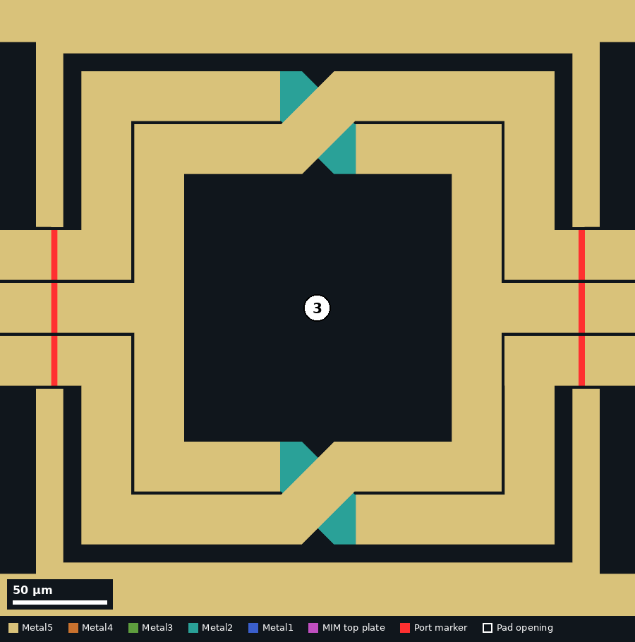 | 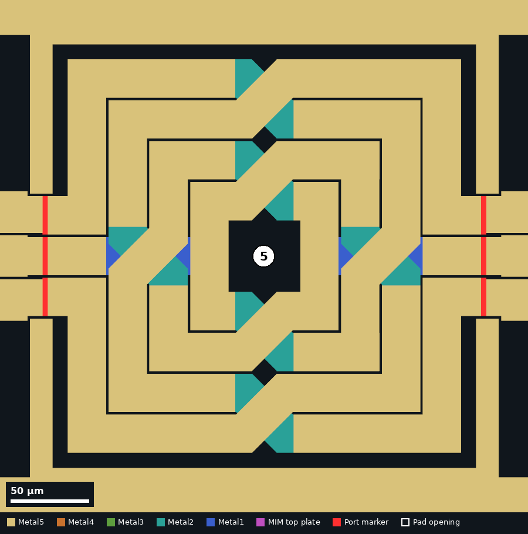 |

Each of the two transformers consists of two interleaved windings with
crossovers. Both are placed in the middle of the die between a three-port
launch on the left edge and one on the right edge, and are connected to each
launch by three Metal5 feed lines.

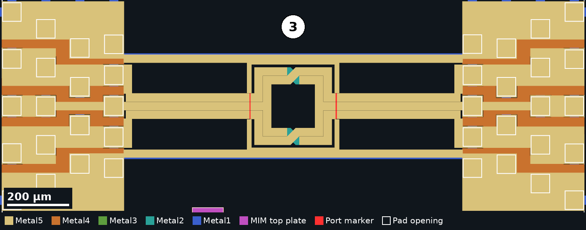

*Transformer 3 with its feed lines, ground rails and launches.*

The windings are named A and B in this documentation. Their terminals are
assigned to the launch pads as follows:

| # | Rings | Track (µm) | Left launch | Right launch |
|---|---|---|---|---|
| [^3] | 2 | 26 | S1 and S3: ends of winding A. S2: centre tap of winding B | S1 and S3: ends of winding B. S2: centre tap of winding A |
| [^5] | 4 | 24 | S1 and S3: ends of winding A. S2: centre tap of winding A | S1 and S3: ends of winding B. S2: centre tap of winding B |

The full description is under
[Transformers in `docs/README.md`](docs/README.md#transformers).

### Measurement

Each transformer is probed on three-port launches on the left and right
edges, with six signal pads in total. A full characterisation is a six-port
measurement. With a four-port network analyser, the four winding ends are
measured on the third pad row of each launch, which has no S2 pad, and the
centre taps are left open. The launches and feed lines are removed using
[^4], [^6] and [^7]. The winding inductances are obtained from `Im(Z)` of
each winding, and the coupling factor from
`k = Im(Z21) / sqrt(Im(Z11) Im(Z22))` with each winding treated as one
differential port.

### Expected values

No expected values are recorded. No hand estimate is given because the
closed-form expression used for the spiral inductors does not cover
interleaved windings. The winding inductances, the coupling factor and the
self-resonant frequency can only be obtained from an EM simulation.

### Further reading

1. V. Mühlhaus, [gds2palace](https://github.com/VolkerMuehlhaus/gds2palace_ihp_sg13g2), the GDS to Palace workflow, with multi-port examples.
2. J. R. Long, "Monolithic transformers for silicon RF IC design", IEEE J. Solid-State Circuits, vol. 35, no. 9, pp. 1368-1382, 2000. [doi:10.1109/4.868049](https://doi.org/10.1109/4.868049)
3. A. M. Niknejad and R. G. Meyer, "Analysis, design, and optimization of spiral inductors and transformers for Si RF ICs", IEEE J. Solid-State Circuits, vol. 33, no. 10, pp. 1470-1481, 1998. [doi:10.1109/4.720393](https://doi.org/10.1109/4.720393)

## De-embedding structures

A measurement of any of the passives includes the pads and feed lines of its
launch. The five de-embedding structures are launches without a device, so
that the contribution of the launch can be measured and removed.

| # | Launch | Signal pads |
|---|---|---|
| [^11] | Two-port | S1 joined to S2 |
| [^12] | Two-port | open |
| [^6] | Three-port | S1, S2 and S3 joined |
| [^7] | Three-port | open |
| [^4] | Three-port, both sides | S1 to S1, S2 to S2 and S3 to S3 through 990 µm lines |

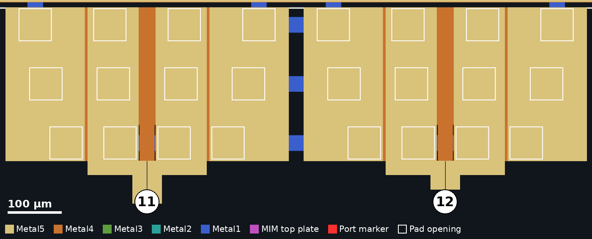

*Two-port launches on the top edge: structure 11 (left, signals joined) and
structure 12 (right, signals open).*

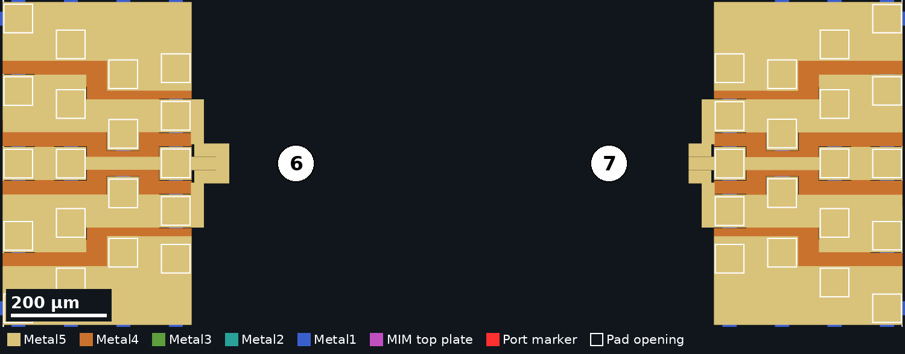

*Three-port launches: structure 6 (left edge, signals joined) and structure 7
(right edge, signals open).*

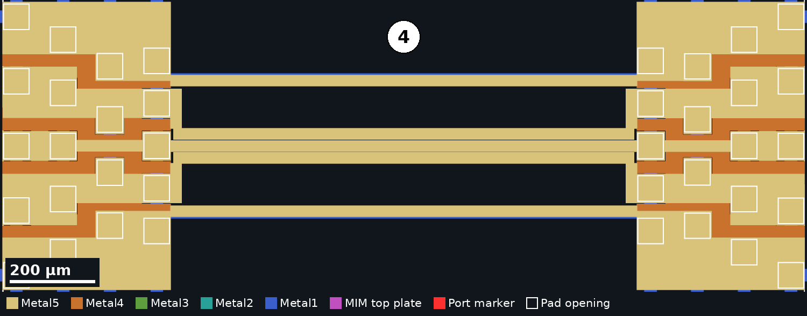

*Structure 4, the three-line thru between two three-port launches.*

In [^6] and [^11] the signal pads are joined to each other. The connectivity
extracted from the layout does not show them connected to the ground pads, so
these structures are not a short to ground in the sense of the open-short
method of [Koolen et al.](https://doi.org/10.1109/BIPOL.1991.160985) The
intended de-embedding procedure is not recorded in this repository.

The full description is under
[De-embedding structures in `docs/README.md`](docs/README.md#de-embedding-structures).

### Measurement

Each de-embedding structure is probed in the same way as the device that it
de-embeds, with the same calibration and probe placement. The launch is then
removed with one of the open-short or thru-based methods listed under
Further reading below.

### Expected values

The open launches are expected to present a small shunt capacitance, and the
joined launches a small series inductance and resistance between the signal
pads. No values are recorded in this repository.

### Further reading

1. M. C. A. M. Koolen, J. A. M. Geelen and M. P. J. G. Versleijen, "An improved de-embedding technique for on-wafer high-frequency characterization", Proc. Bipolar Circuits and Technology Meeting, pp. 188-191, 1991. [doi:10.1109/BIPOL.1991.160985](https://doi.org/10.1109/BIPOL.1991.160985)
2. H. Cho and D. E. Burk, "A three-step method for the de-embedding of high-frequency S-parameter measurements", IEEE Trans. Electron Devices, vol. 38, no. 6, pp. 1371-1375, 1991. [doi:10.1109/16.81628](https://doi.org/10.1109/16.81628)
3. T. E. Kolding, "A four-step method for de-embedding gigahertz on-wafer CMOS measurements", IEEE Trans. Electron Devices, vol. 47, no. 4, pp. 734-740, 2000. [doi:10.1109/16.830987](https://doi.org/10.1109/16.830987)
4. L. F. Tiemeijer and R. J. Havens, "A calibrated lumped-element de-embedding technique for on-wafer RF characterization of high-quality inductors and high-speed transistors", IEEE Trans. Electron Devices, vol. 50, no. 3, pp. 822-829, 2003. [doi:10.1109/TED.2003.811396](https://doi.org/10.1109/TED.2003.811396)
5. H. Ito and K. Masu, "A simple through-only de-embedding method for on-wafer S-parameter measurements up to 110 GHz", IEEE MTT-S Int. Microwave Symp. Digest, pp. 383-386, 2008. [doi:10.1109/MWSYM.2008.4633183](https://doi.org/10.1109/MWSYM.2008.4633183)

## Simulating the structures

The stated purpose of the chip is to verify an openEMS simulation flow
against silicon. This repository holds only layout. It contains no simulation
scripts, no stack file and no simulated results, and it does not name the
flow. The following components are published elsewhere:

| Component | Location |
|---|---|
| GDS to openEMS workflow | [VolkerMuehlhaus/gds2openEMS](https://github.com/VolkerMuehlhaus/gds2openEMS) |
| GDS to Palace workflow | [VolkerMuehlhaus/gds2palace_ihp_sg13g2](https://github.com/VolkerMuehlhaus/gds2palace_ihp_sg13g2) |
| GF180MCUD stack files for both, by the author of this chip | [`EM-Flow/` in EngGhaith/The-Silent-Owl-GF180MCU-WB-LNA](https://github.com/EngGhaith/The-Silent-Owl-GF180MCU-WB-LNA/tree/main/EM-Flow) |
| Stack viewer | [VolkerMuehlhaus/setupEM](https://github.com/VolkerMuehlhaus/setupEM) |

These workflows take a GDS file, an XML description of the metal and
dielectric stack, and a Python model script. Ports are drawn in the GDS as
polygons on additional layers, by convention 201 and above, and the model
script maps each layer to a port number. The inductor and transformer cells
on this chip carry such polygons on layers 201 to 207. They are the red marks
in the pictures and are listed per cell under
[EM port markers in `docs/README.md`](docs/README.md#em-port-markers).

### Procedure

To produce the expected S-parameters for one structure:

1. Unzip [`RLCMV4_filled.zip`](RLCMV4_filled.zip) and extract the required
   cell, or start from a file in [`seperate_GDSs/`](seperate_GDSs/README.md).
2. Take [`OPENEMS-GF180MCUD-1P5M-TM11KA-MIMB.xml`](https://github.com/EngGhaith/The-Silent-Owl-GF180MCU-WB-LNA/blob/main/EM-Flow/OPENEMS-GF180MCUD-1P5M-TM11KA-MIMB.xml)
   and read the [README next to it](https://github.com/EngGhaith/The-Silent-Owl-GF180MCU-WB-LNA/blob/main/EM-Flow/README.md),
   in particular the note on MIM vias.
3. Write a gds2openEMS model script that maps the port layers to ports,
   following the
   [gds2openEMS user guide](https://github.com/VolkerMuehlhaus/gds2openEMS/blob/main/doc/userguide_md_format/Using_OpenEMS_Python_with_IHP_SG13G2_v3.md).
4. Run the script and compare the resulting Touchstone file with the
   de-embedded measurement.

Steps 3 and 4 have not been carried out as part of this documentation.

### Further reading

1. G. Al Sabagh, "The Design Journey of mWATTBAT: The Open-Source Radar Chip", master's thesis, Johannes Kepler University Linz, 2026, which has a section on transmission lines in openEMS. [PDF](https://epub.jku.at/download/pdf/13546624.pdf)
2. V. Mühlhaus, "User friendly workflow for RFIC EM simulation using openEMS", talk at the Free Silicon Conference, 2025. [Programme](https://wiki.f-si.org/FSiC2025)
3. T. Liebig, A. Rennings, S. Held and D. Erni, "openEMS: a free and open source equivalent-circuit (EC) FDTD simulation platform supporting cylindrical coordinates suitable for the analysis of traveling wave MRI applications", Int. J. Numerical Modelling, vol. 26, no. 6, pp. 680-696, 2013. [doi:10.1002/jnm.1875](https://doi.org/10.1002/jnm.1875)
4. [openEMS](https://www.openems.de/) and [Palace](https://awslabs.github.io/palace/stable/) project pages.

## License

The wafer.space project page lists this design under the CERN Open Hardware
Licence Version 2, Permissive
([`CERN-OHL-P-2.0`](https://spdx.org/licenses/CERN-OHL-P-2.0.html)). The full
text is in [`LICENSE`](LICENSE).

## Citing this work

No publication describes this chip yet. Until one does, the repository and
the shuttle can be cited as follows:

```bibtex
@misc{alsabagh2026rlcm,
  author       = {Al Sabagh, Ghaith},
  title        = {{RLCM}: Test Passives for {GF180MCUD}},
  year         = {2026},
  howpublished = {\url{https://github.com/EngGhaith/RLCM-Test-Passives-For-GF180MCUD}},
  note         = {wafer.space GF180MCU Run 2, manufacturing ID G802RLCM}
}
```

### Related work by the same author

- G. Al Sabagh, G. Zachl and H. Pretl, "A 150-GHz 9-dBm EIRP Open-Source FMCW
  Radar Chip in 130-nm BiCMOS", Austrochip Workshop on Microelectronics,
  pp. 13-16, 2025.
  [doi:10.1109/Austrochip67945.2025.11183716](https://doi.org/10.1109/Austrochip67945.2025.11183716)

## Acknowledgements

The credits are written on the die in Metal5, above transformer [^5]:

> DESIGNED BY GHAITH AL SABAGH, NTHFS JKU, MWTH CD LAB
>
> THANK U MIM, THANK U SHO, THANK U VOLKER MUEHLHAUS, THANK U LEO MOSER

The names on the die refer to:

| Name on the die | Refers to |
|---|---|
| NTHFS JKU | [Institute for Communications Engineering and RF-Systems](https://www.jku.at/en/institute-for-communications-engineering-and-rf-systems/), Johannes Kepler University Linz |
| MWTH CD LAB | [Christian Doppler Laboratory for Distributed Microwave and Terahertz Systems for Sensors and Data Links](https://www.jku.at/en/news-events/news/detail/news/neues-cd-labor-an-der-jku-hochfrequenzsysteme-fuer-moderne-elektronik/) |
| Volker Muehlhaus | Author of the [gds2openEMS](https://github.com/VolkerMuehlhaus/gds2openEMS) and [gds2palace](https://github.com/VolkerMuehlhaus/gds2palace_ihp_sg13g2) workflows |
| Leo Moser | Not stated in this repository |
| MIM, SHO | Not stated in this repository |

The chip was fabricated through [wafer.space](https://wafer.space/) and uses
its GF180MCU frame, logo and ID cells.
